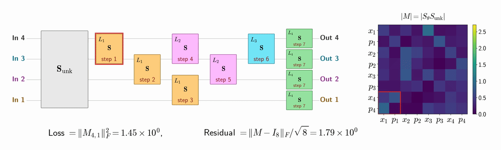

# Symplectic Reck

Simulations of a symplectic Reck mesh trained to invert an unknown Gaussian operation
by nulling response blocks.



## Contents

```text
symplectic_reck/
├── gates.py
├── targets.py
├── measurements.py
├── nulling_gateorder.py
├── nulling_analytical.py
├── nulling_feedback.py
├── run_nulling_sequence.py
├── matrix_utils.py
├── gate_errors.py
├── io_utils.py
├── experiments/
│   ├── run_four_mode_nulling.py
│   ├── run_fourmode_nulling_animation.py
│   ├── run_conditioning.py
│   ├── run_finite_shots.py
│   ├── run_insitu_vs_tomog_with_gate_errors.py
│   ├── run_loss_simulations.py
│   └── run_universal_architecture.py
├── plotting/
├── tests/
├── results/
└── run_all.sh
```

Matrices use `(x₁, p₁, x₂, p₂, …)` ordering. Python mode indices start at zero.

## Quick start

From the repository root:

```bash
python -m pip install -r requirements.txt
python -m symplectic_reck.experiments.run_four_mode_nulling
python -m symplectic_reck.plotting.plot_four_mode_nulling
python -m unittest discover -s symplectic_reck/tests
```

Run the main experiments and plots:

```bash
bash symplectic_reck/run_all.sh 4
```

The argument sets the number of parallel workers for the finite-shot sweep
(default 4).

Outputs go to `symplectic_reck/results/`. The animation
above is regenerated with `python -m symplectic_reck.experiments.run_fourmode_nulling_animation`.
